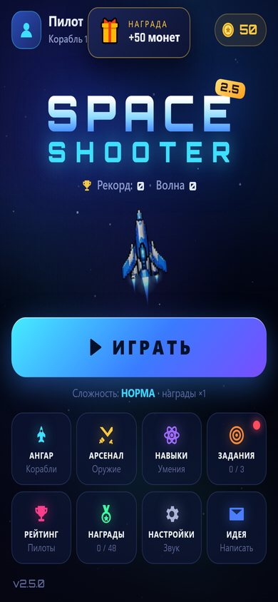
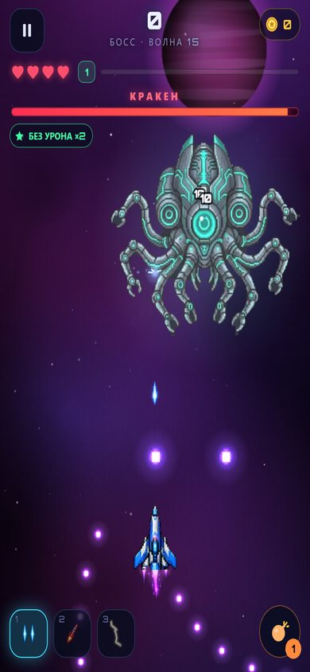
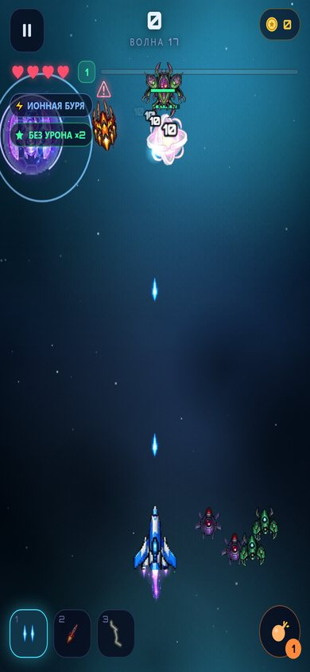
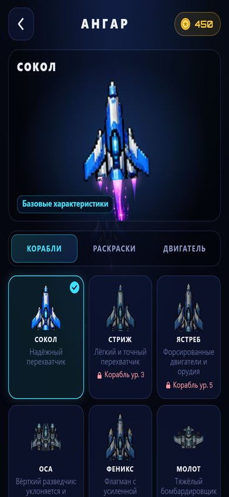

# Space Shooter

Неоновый вертикальный шутер в стиле пиксель-арт для Telegram Mini App и браузера. Ведите корабль пальцем, стрельба автоматическая. Волны врагов, 13 боссов, улучшения в каждом забеге и прокачка между забегами.

**▶ Играть:** https://vladzah403.github.io/space-shooter-game/

<p align="center">
  
  
  
  
</p>

## Что есть в игре

- **Бой.** 7 видов оружия (лазер, дробовик, ракеты, дуга, плазма, молния, тёмная материя), 30+ типов врагов, 5 мини-боссов и 13 боссов со своими атаками.
- **Забег.** На каждом новом уровне выбор 1 из 3 улучшений. Эволюции оружия: лазер становится Лучом, ракеты — кассетными, молния — Ледяной цепью.
- **События волны.** С 6-й волны иногда приходят ионная буря, метеоритный дождь, солнечная вспышка или космический мусор и меняют правила на одну волну.
- **Испытание дня.** Каждый день (по UTC) у всех игроков одинаковые особые правила, волны и улучшения; награды за 10-ю, 20-ю и 30-ю волну.
- **Прокачка.** Арсенал, улучшения корабля, дерево навыков, 13 кораблей, раскраски и шлейфы двигателя, престиж.
- **Цели.** Достижения, ежедневные задания, награда за вход по дням.
- **Шесть сложностей,** от «Зена» до «Бога войны».
- **Платформа.** Сохранение в облаке Telegram, работа офлайн (PWA), автоподбор качества графики под телефон.

## Управление

| Действие | Телефон | Клавиатура |
|---|---|---|
| Полёт | вести пальцем по экрану | стрелки / WASD |
| Бомба | двойной тап или кнопка | Пробел / B |
| Навыки | кнопки навыков | Q / E |
| Смена оружия | кнопки оружия | 1 / 2 / 3 |
| Пауза | кнопка ⏸ | Esc / P |

## Запуск локально

Сборка не нужна: это статический сайт на чистом JavaScript (Canvas 2D), без зависимостей.

```bash
python -m http.server 8765
# открыть http://127.0.0.1:8765/
```

Режим разработчика: `?dev=1` (бесплатные покупки, кнопки выдачи монет в настройках). Заставка в этом режиме выключена, включить её можно с `?dev=1&intro=1`.

## Устройство проекта

```
index.html            разметка экранов и подключение скриптов
sw.js                 service worker (офлайн, сначала сеть)
manifest.json         PWA
css/style.css         весь интерфейс
js/
  config.js           адрес API и параметр режима разработчика
  core.js             утилиты, шина событий, пул объектов, версия
  data.js             весь контент: оружие, враги, боссы, перки, корабли, достижения, события
  store.js            сохранение, перенос старых версий, мета-прогрессия
  tg.js               Telegram WebApp: облако, вибрация, кнопка «назад»
  audio.js            синтез звуков и музыки (Web Audio, без файлов)
  gfx.js              атлас спрайтов, перекраска, фон
  fx.js               частицы, взрывы, кольца, текст, экранные эффекты
  game.js             игровой цикл, игрок, оружие, перки, волны
  enemies.js          поведение врагов, мини-боссов и боссов
  events.js           события волны
  intro.js            заставка при запуске
  ui.js               меню, HUD, магазины, настройки
  main.js             загрузка, цикл кадров, качество графики
  atlas.js            координаты кадров (генерируется)
assets/               собранные атласы sprites*.webp / .png (генерируются)
art/                  исходные листы спрайтов
tools/extract_sprites.py   сборка атласа из листов в art/
docs/                 скриншоты для README
```

Почти всё, что влияет на баланс (цены, урон, шансы, частота событий, правила испытания), находится в `js/data.js`. Логику при этом трогать не нужно.

### Спрайты

Исходные листы лежат в `art/`, координаты кадров описаны в словаре `SPRITES` в `tools/extract_sprites.py`. После изменений атлас нужно пересобрать:

```bash
pip install pillow
python tools/extract_sprites.py
```

Скрипт обновляет `assets/sprites*.webp`, `assets/sprites*.png` и `js/atlas.js`. Эти файлы коммитятся вместе. Большие спрайты боссов уходят во второй атлас `sprites2`, который догружается после появления меню.

## Выпуск новой версии

1. Поднять версию в трёх местах: `SS.VERSION` в `js/core.js`, `VERSION` в `sw.js`, `?v=` у скриптов и стилей в `index.html` и `sw.js`. Значок версии на логотипе берётся из `SS.VERSION` сам; цифру в `<span class="ver">` и `<span class="l3">` в `index.html` (видна только во время загрузки) меняйте при смене первых двух чисел версии.
2. Если добавлены новые поля сохранения, дописать их в `defaults()` в `js/store.js`. Старые сохранения дополняются автоматически.
3. Для заметок «что нового» поднять `patch` в `store.js` и добавить окно в `showNotes()` в `main.js`.
4. Закоммитить и запушить. Сайт публикуется через GitHub Pages.

## Telegram-бот (необязательно)

`bot.py`, `api.py`, `database.py` и `config.py` — бот с кнопкой запуска игры и сервер онлайн-рейтинга. Игра работает и без них: пока `API_URL` в `js/config.js` пустой, рейтинг локальный.

```bash
pip install -r requirements.txt
cp .env.example .env     # вписать BOT_TOKEN и ADMIN_CHAT_ID
python bot.py
```

Токен бота хранится только в `.env`, этот файл в git не попадает.
